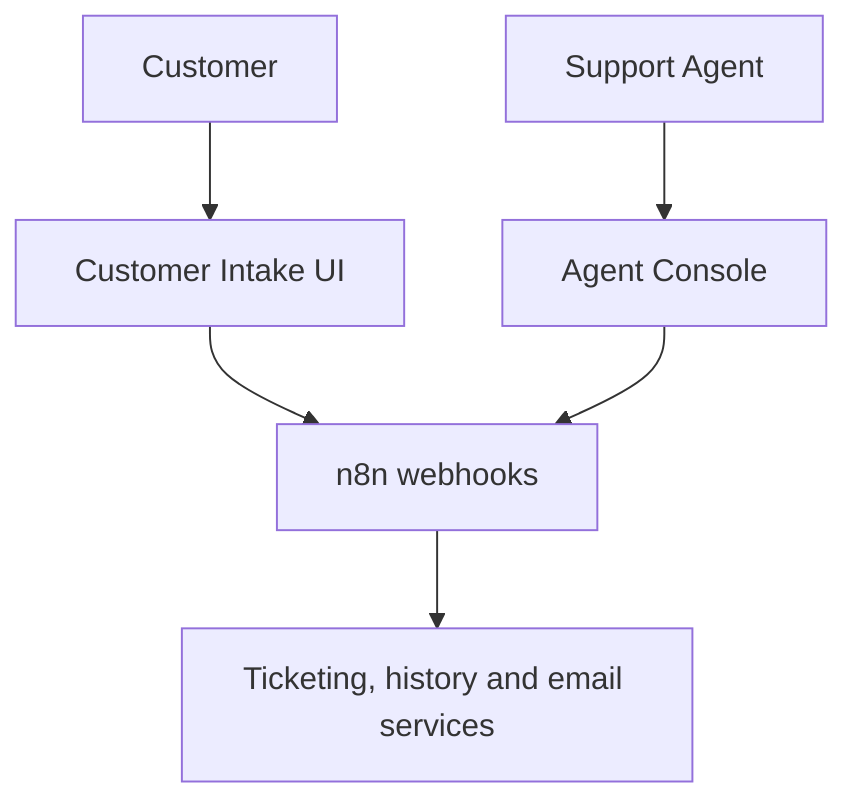

# AI Ticketing System — Streamlit UI + n8n

An AI-assisted customer-support ticketing interface built with Streamlit and connected to an n8n automation backend through secured webhooks.

The project provides two separate interfaces:

- **Customer Intake** — customers submit support requests and receive a ticket reference.
- **Agent Console** — support agents review high-priority tickets, inspect historical context, reply to customers, and close resolved issues.

n8n acts as the orchestration layer between the Streamlit applications and the external services used for ticket management, historical context, and customer email notifications.

## Features

### Customer interface

- Simple support-ticket submission form
- Required subject, description, order number, and email fields
- Automatic ticket-reference display after successful submission
- Secure communication with n8n using an API-token header
- Clear validation, loading, success, and error states

### Agent interface

- High-priority ticket queue
- Requester avatars generated from names or email addresses
- Ticket subject, status, and priority display
- Detailed ticket view
- Similar historical tickets for reference
- Previous tickets from the same reporter
- Agent reply submission
- Ticket closure and customer-email confirmation
- Manual queue refresh and session-based UI state

## System Architecture



The Streamlit applications are thin clients. Business logic and external integrations are handled by n8n workflows:

1. A customer submits a ticket through `customer_app.py`.
2. The application sends the ticket to the n8n intake webhook.
3. n8n creates the ticket in the configured ticketing system and returns its reference.
4. An agent opens `agent_app.py`, which retrieves the high-priority queue from n8n.
5. Selecting a ticket requests its details and historical context.
6. The agent writes a response and submits it to n8n.
7. The relevant n8n workflow posts the reply, closes the ticket, and sends the customer notification.

## Technology Stack

| Component | Technology |
| --- | --- |
| Customer interface | Streamlit |
| Agent interface | Streamlit |
| Workflow automation | n8n |
| API communication | Python Requests and JSON webhooks |
| Authentication | Shared token in the `X-API-Token` header |
| Ticketing and email services | Configured within n8n |

## Repository Structure

```text
App-Ticketing-UI/
├── customer_app.py   # Customer ticket-submission interface
├── agent_app.py      # Support-agent queue and ticket console
└── requirements.txt  # Python dependencies
```

> The n8n workflow exports are not included in this repository. Four compatible, active n8n webhook workflows must be configured separately.

## Required n8n Webhooks

The applications expect four `POST` endpoints:

| Application | Purpose | Default path | Configurable secret |
| --- | --- | --- | --- |
| Customer | Submit a new ticket | `/ticket-api` | `INTAKE_URL` |
| Agent | Retrieve the priority queue | `/agent-queue` | `QUEUE_URL` |
| Agent | Retrieve ticket details and context | `/agent-detail` | `DETAIL_URL` |
| Agent | Send a reply and close the ticket | `/agent-answer` | `ANSWER_URL` |

Every request includes this header:

```http
X-API-Token: your-shared-api-token
```

Each n8n workflow should verify the token before processing the request and return HTTP `401 Unauthorized` when it is missing or invalid.

## Webhook Data Contracts

### 1. Ticket intake

The customer application sends:

```json
{
  "subject": "Order has not arrived",
  "description": "My delivery was expected yesterday but has not arrived.",
  "orderNumber": "ORD-12345",
  "reporterEmail": "customer@example.com"
}
```

Expected successful response:

```json
{
  "ticketId": "SUP-101"
}
```

### 2. Agent queue

The agent application sends an empty JSON object and expects:

```json
{
  "tickets": [
    {
      "key": "SUP-101",
      "reporterEmail": "customer@example.com",
      "summary": "Order has not arrived",
      "status": "To Do",
      "priority": "high"
    }
  ]
}
```

For the requester label, the interface checks `reporter`, `reporterEmail`, and then `email`.

### 3. Ticket details

The agent application sends:

```json
{
  "ticketKey": "SUP-101"
}
```

Expected response:

```json
{
  "key": "SUP-101",
  "reporterEmail": "customer@example.com",
  "summary": "Order has not arrived",
  "description": "My delivery was expected yesterday but has not arrived.",
  "status": "To Do",
  "priority": "high",
  "historical_context": "Relevant resolved tickets and their solutions...",
  "reporter_history": "Previous tickets submitted by this customer..."
}
```

### 4. Agent answer

The agent application sends:

```json
{
  "ticketKey": "SUP-101",
  "reply": "We have located your order and arranged a replacement delivery."
}
```

Expected successful response:

```json
{
  "ok": true
}
```

An unsuccessful response can return:

```json
{
  "ok": false,
  "error": "Description of the failure"
}
```

## Local Installation

1. Clone the repository:

   ```bash
   git clone https://github.com/laszloboruzs26-cmyk/App-Ticketing-UI.git
   cd App-Ticketing-UI
   ```

2. Create and activate a virtual environment:

   ```bash
   python3 -m venv .venv
   source .venv/bin/activate
   ```

   On Windows PowerShell:

   ```powershell
   .venv\Scripts\Activate.ps1
   ```

3. Install the dependencies:

   ```bash
   pip install -r requirements.txt
   ```

## Configuration

Create `.streamlit/secrets.toml` and configure the shared token and production webhook URLs:

```toml
API_TOKEN = "replace-with-a-long-random-token"

INTAKE_URL = "https://your-n8n-instance.example/webhook/ticket-api"
QUEUE_URL = "https://your-n8n-instance.example/webhook/agent-queue"
DETAIL_URL = "https://your-n8n-instance.example/webhook/agent-detail"
ANSWER_URL = "https://your-n8n-instance.example/webhook/agent-answer"
```

The same `API_TOKEN` must be validated inside all four n8n workflows. Never commit `.streamlit/secrets.toml` or any credentials to GitHub.

If a URL secret is omitted, the application falls back to the n8n Cloud webhook address currently defined in the corresponding Python file. Explicitly setting all four URLs is recommended for development, testing, and deployment.

## Running the Applications

Run the customer interface:

```bash
streamlit run customer_app.py --server.port 8501
```

In a second terminal, run the agent interface on a different port:

```bash
streamlit run agent_app.py --server.port 8502
```

Open the URLs displayed in the terminal. They will normally be:

- Customer interface: `http://localhost:8501`
- Agent console: `http://localhost:8502`

## n8n Workflow Setup

For each operation:

1. Create an n8n workflow with a **Webhook** trigger using the `POST` method.
2. Assign the matching production path from the webhook table above.
3. Validate the incoming `X-API-Token` header before continuing.
4. Validate and sanitise the request body.
5. Perform the required ticketing, history, or email operations.
6. Return JSON in the format documented in the data contracts.
7. Activate the workflow and copy its production webhook URL into Streamlit secrets.

Use n8n's test webhook only during workflow development. The deployed Streamlit applications should use active production webhook URLs.

## Deployment

Because the repository contains two Streamlit entry points, deploy it as two applications from the same repository:

| Deployment | Main file |
| --- | --- |
| Customer portal | `customer_app.py` |
| Agent console | `agent_app.py` |

For each deployment:

1. Select this GitHub repository in Streamlit Community Cloud.
2. Choose the relevant main file.
3. Add the required secrets under **App settings → Secrets**.
4. Deploy and test its n8n webhook connection.

The customer portal can be shared publicly if appropriate. The agent console should be restricted to authorised support staff.

## Security Recommendations

- Replace the example token with a long, randomly generated value.
- Use HTTPS production webhook URLs only.
- Compare tokens securely in every n8n workflow.
- Add authentication to the agent console before production use.
- Validate email addresses, order numbers, and message lengths in n8n.
- Do not return internal workflow errors or credentials to customers.
- Apply rate limiting to the public ticket-intake endpoint.
- Store service credentials in n8n credentials and Streamlit secrets.
- Avoid logging complete customer messages if they can contain personal data.

## Current Scope

This repository contains the user interfaces and webhook client logic. It does not currently include:

- Exported n8n workflow JSON files
- Built-in agent authentication or role-based access control
- Automated tests
- Persistent Streamlit session data
- Local ticket storage
- Deployment configuration files

These functions can be added without changing the main UI structure, provided the webhook contracts remain compatible.

## Author

Developed by [Laszlo Boruzs](https://github.com/laszloboruzs26-cmyk).

