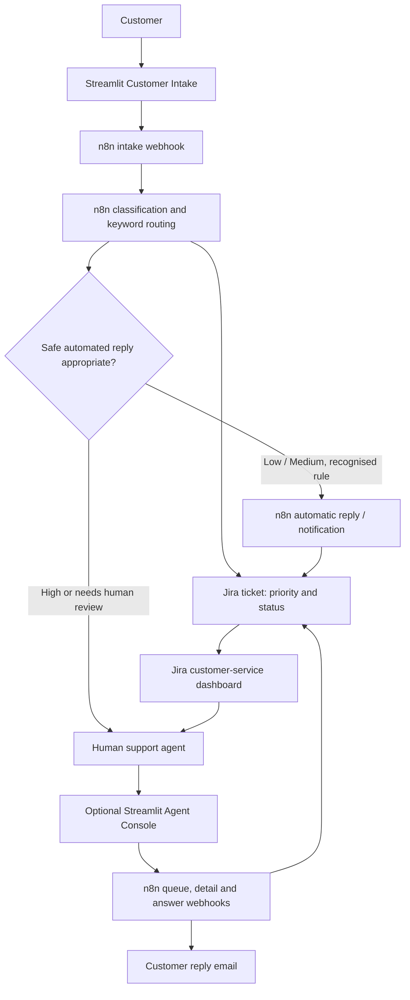

# AI Ticketing System — Streamlit + n8n + Jira

An AI-assisted customer-support ticketing system combining **Streamlit customer intake**, **n8n ticket triage and automation**, and **Jira as the customer-service ticket management dashboard**. A separate Streamlit Agent Console provides a custom view for human-operated escalations.

The solution has three operational surfaces:

- **Customer Intake (Streamlit)** — customers submit requests and receive a ticket reference.
- **Automation (n8n)** — incoming requests are classified by priority; recognised low- and medium-priority requests can follow keyword-triggered automatic-reply paths; high-priority or unsuitable cases are sent for human review.
- **Agent workspace (Jira, with an optional Streamlit Agent Console)** — Jira tracks customer-service tickets, priorities, statuses and human-agent work. The custom agent interface fetches escalations and context via n8n and supports manual replies and closure.

**Code coverage:** this repository contains the two Streamlit applications and their webhook contracts. The n8n workflow definitions, exact keyword lists, AI classification instructions, Jira configuration and email-service setup live outside the repository and cannot be independently verified from this code alone.

## Features

### Customer interface

- Simple support-ticket submission form
- Required subject, description, order number, and email fields
- Automatic ticket-reference display after successful submission
- Priority and keyword-based routing performed downstream by n8n (not by the customer UI)
- Secure communication with n8n using an API-token header
- Clear validation, loading, success, and error states

### Jira customer-service dashboard and Streamlit agent interface

- **Jira** is the external ticket-management/agent dashboard: agents can track and work on tickets created or updated through n8n
- **Streamlit Agent Console** is an additional, custom interface for the high-priority queue
- Requester avatars generated from names or email addresses
- Ticket subject, status, and priority display
- Detailed ticket view
- Similar historical tickets for reference
- Previous tickets from the same reporter
- Agent reply submission
- Ticket closure and customer-email confirmation
- Manual queue refresh and session-based UI state

## System Architecture

The system has two stages: **ticket intake and automated triage**, followed by **automatic resolution (where safe) or human escalation**.



1. The customer submits a subject, description, order number and email address through `customer_app.py`.
2. The customer UI posts those fields to n8n; **the Streamlit application does not assign a ticket priority**.
3. In the external n8n workflow, the request is triaged using its content. The workflow is responsible for identifying priority, selecting a route and mapping the resulting priority to Jira.
4. Jira holds the support ticket so agents can review its priority, status and history in their customer-service dashboard.
5. Recognised **low- or medium-priority** requests can receive an automatic response through n8n when the relevant keyword rule and safety conditions are met. Unrecognised or ambiguous cases should be routed for review rather than assumed resolved.
6. **High-priority** requests are handled by a human support agent. Agents can work in Jira and use `agent_app.py` as a specialised escalation interface.
7. The Streamlit agent interface retrieves the queue and ticket details through n8n, including similar historical tickets and the reporter's prior tickets where supplied by the detail webhook.
8. A human agent sends a reply using the answer webhook; the backend is responsible for updating Jira, closing the ticket when appropriate and emailing the customer.

> **Verification boundary:** the exact n8n nodes, classification model or prompt, keyword match expressions, Jira issue-type/priority mappings, email templates and auto-close rules are **not in this repository**. The workflow above documents the integration and routing behaviour described for the project; it is not a claim that those rules were verified in exported n8n code.

## Priority classification, keyword auto-replies and escalation

### How n8n determines priority

**Priority is decided downstream of the ticket-submission UI**, in the n8n intake/triage workflow. The available input fields are `subject`, `description`, `orderNumber` and `reporterEmail`. The routing design classifies the customer's request by its meaning and urgency and uses the result to set or update the corresponding ticket priority in Jira.

The priorities have different treatment:

| Priority | Intended treatment | Agent involvement |
| --- | --- | --- |
| **Low** | Routine or informational request; eligible for a pre-approved automatic reply when a matching keyword/intent is recognised and sufficient information is available | Usually no immediate human action for successfully handled requests |
| **Medium** | Non-critical service issue; eligible for a conditional automatic reply or follow-up request where safe, otherwise manual review | Agent review when the issue is unresolved, sensitive or uncertain |
| **High** | Urgent, consequential or sensitive issue; create/escalate the Jira ticket and present it in the human-support queue | Human agent investigates, replies and resolves |

**These are routing categories, not verified numeric priority thresholds.** The repository does not expose whether a particular n8n branch uses keyword conditions, an LLM classifier, or both, nor how conflicting matches are resolved. Those implementation details should be checked against a redacted export of the deployed n8n workflow.

### Keyword-triggered auto-replies: Low and Medium

The project includes a **conditional auto-response path for customer messages containing recognised words or phrases**. Keyword or intent detection belongs in n8n rather than in either Streamlit application. A matching trigger should select a suitable response template or AI-assisted response *only* where sufficient verified customer/order context is available.

| Illustrative customer query | Example phrase to recognise | Illustrative priority / path |
| --- | --- | --- |
| "Where can I track my order?" | `track my order`, `tracking` | **Low:** provide an approved tracking instruction or request missing order details |
| "Can you tell me my order status?" | `order status` | **Low:** approved status guidance, or a follow-up when live order information is unavailable |
| "I cannot log into my account and need help." | `cannot log in`, `login` | **Medium:** offer safe troubleshooting or request more information; escalate identity/security-sensitive actions |
| "My delivery is delayed." | `delayed delivery`, `not arrived` | **Medium:** acknowledge and provide approved next steps, or escalate if the issue requires investigation |
| "There is an unauthorised charge on my account." | `unauthorised charge`, `fraud` | **High / human review:** do not auto-resolve a sensitive financial/security complaint |

**The phrases above are examples, NOT a verified list of deployed n8n triggers.** Replace them with exact words, conditions and templates from the actual workflow export before claiming these specific matches are live. The examples also show intended treatment rather than evidence that each message always receives that priority.

The intended decision sequence is:

1. Inspect the submitted text and determine the priority.
2. Check whether a low/medium ticket matches an approved automation rule and has enough context for a safe response.
3. If eligible, send the pre-approved response or follow-up and update the Jira issue appropriately.
4. Otherwise, route the ticket to a human agent; **high-priority tickets must not be automatically marked resolved solely because a keyword matched**.
5. Record the route and result so support agents can audit what happened.

### Jira as the customer-service agent dashboard

**Jira is the external system of record for ticket management**, while n8n is the integration/automation layer and Streamlit is the custom front end. During development, the Jira project was named **Ticketing App** with the project key `KAN`; its configuration and active credentials are not stored in this repository.

- n8n is responsible for creating/updating Jira issues, including the classified priority and status.
- Human agents use the **Jira dashboard/board** to review and manage escalated customer requests.
- The custom **Streamlit Agent Console** offers an additional high-priority queue, retrieved via `/agent-queue`, and ticket details via `/agent-detail`.
- `/agent-answer` passes a manual reply to n8n; the connected workflow carries out the Jira update and customer notification.

The Streamlit queue **does not calculate or filter priority client-side**: `agent_app.py` displays the `tickets` array returned by n8n, and marks tickets as high priority when the supplied `priority` field equals `high`. The queue webhook must therefore apply the intended filtering before returning results.

## Technology Stack

| Component | Technology |
| --- | --- |
| Customer interface | Streamlit |
| Agent interface | Streamlit |
| Workflow automation, priority routing and auto-reply branching | n8n (external workflows) |
| Customer-service ticket dashboard and tracking | Jira (external integration) |
| AI classification / response generation | Configured in external n8n workflow, if enabled; model and prompts not included here |
| API communication | Python Requests and JSON webhooks |
| Webhook authentication | Shared token in the `X-API-Token` header |
| Customer email service | Configured within n8n; provider not specified in this repository |

## Repository Structure

```text
App-Ticketing-UI/
├── customer_app.py            # Customer ticket-submission interface
├── agent_app.py               # Optional high-priority agent console
├── requirements.txt           # Python dependencies
├── .devcontainer/
│   └── devcontainer.json      # Development-container configuration
└── README.md                  # Architecture, contracts and setup
```

> The n8n workflow exports and Jira configuration are **not** included in this repository. Four compatible, active n8n webhook workflows must be configured separately.

## Required n8n Webhooks

The applications expect four `POST` endpoints:

| Application | Purpose | Default path | Configurable secret |
| --- | --- | --- | --- |
| Customer | Submit a new ticket | `/ticket-api` | `INTAKE_URL` |
| Agent | Retrieve the priority queue | `/agent-queue` | `QUEUE_URL` |
| Agent | Retrieve ticket details and context | `/agent-detail` | `DETAIL_URL` |
| Agent | Send a reply and close the ticket | `/agent-answer` | `ANSWER_URL` |

Every request includes this header:

```http
X-API-Token: your-shared-api-token
```

Each n8n workflow should verify the token before processing the request and return HTTP `401 Unauthorized` when it is missing or invalid.

## Webhook Data Contracts

### 1. Ticket intake

The customer application sends **raw customer input only**; n8n determines priority, automated-reply eligibility and the Jira ticket fields downstream:

```json
{
  "subject": "Order has not arrived",
  "description": "My delivery was expected yesterday but has not arrived.",
  "orderNumber": "ORD-12345",
  "reporterEmail": "customer@example.com"
}
```

Expected successful response:

```json
{
  "ticketId": "SUP-101"
}
```

### 2. Agent queue

The agent application sends an empty JSON object and expects:

```json
{
  "tickets": [
    {
      "key": "SUP-101",
      "reporterEmail": "customer@example.com",
      "summary": "Order has not arrived",
      "status": "To Do",
      "priority": "high"
    }
  ]
}
```

For the requester label, the interface checks `reporter`, `reporterEmail`, and then `email`. The example priority queue contains a high-priority ticket, but filtering must occur **in n8n / the upstream Jira query**, not in the Streamlit UI.

### 3. Ticket details

The agent application sends:

```json
{
  "ticketKey": "SUP-101"
}
```

Expected response:

```json
{
  "key": "SUP-101",
  "reporterEmail": "customer@example.com",
  "summary": "Order has not arrived",
  "description": "My delivery was expected yesterday but has not arrived.",
  "status": "To Do",
  "priority": "high",
  "historical_context": "Relevant resolved tickets and their solutions...",
  "reporter_history": "Previous tickets submitted by this customer..."
}
```

### 4. Agent answer

The agent application sends:

```json
{
  "ticketKey": "SUP-101",
  "reply": "We have located your order and arranged a replacement delivery."
}
```

Expected successful response:

```json
{
  "ok": true
}
```

An unsuccessful response can return:

```json
{
  "ok": false,
  "error": "Description of the failure"
}
```

## Local Installation

1. Clone the repository:

   ```bash
   git clone https://github.com/laszloboruzs26-cmyk/App-Ticketing-UI.git
   cd App-Ticketing-UI
   ```

2. Create and activate a virtual environment:

   ```bash
   python3 -m venv .venv
   source .venv/bin/activate
   ```

   On Windows PowerShell:

   ```powershell
   .venv\Scripts\Activate.ps1
   ```

3. Install the dependencies:

   ```bash
   pip install -r requirements.txt
   ```

## Configuration

Create `.streamlit/secrets.toml` and configure the shared token and production webhook URLs:

```toml
API_TOKEN = "replace-with-a-long-random-token"

INTAKE_URL = "https://your-n8n-instance.example/webhook/ticket-api"
QUEUE_URL = "https://your-n8n-instance.example/webhook/agent-queue"
DETAIL_URL = "https://your-n8n-instance.example/webhook/agent-detail"
ANSWER_URL = "https://your-n8n-instance.example/webhook/agent-answer"
```

The same `API_TOKEN` must be validated inside all four n8n workflows. Never commit `.streamlit/secrets.toml` or any credentials to GitHub.

If a URL secret is omitted, the application falls back to the n8n Cloud webhook address currently defined in the corresponding Python file. Explicitly setting all four URLs is recommended for development, testing, and deployment.

## Running the Applications

Run the customer interface:

```bash
streamlit run customer_app.py --server.port 8501
```

In a second terminal, run the agent interface on a different port:

```bash
streamlit run agent_app.py --server.port 8502
```

Open the URLs displayed in the terminal. They will normally be:

- Customer interface: `http://localhost:8501`
- Agent console: `http://localhost:8502`

## n8n Workflow Setup

For each operation:

1. Create an n8n workflow with a **Webhook** trigger using the `POST` method.
2. Assign the matching production path from the webhook table above.
3. Validate the incoming `X-API-Token` header before continuing.
4. Validate and sanitise the request body.
5. For the **intake** workflow, classify priority from the request, apply keyword-based low/medium auto-reply rules where appropriate, and create/update the Jira ticket. Escalate high-priority and unsafe/unrecognised cases for human action.
6. For the **queue** workflow, query Jira for the intended high-priority human-work items and return them as the `tickets` array.
7. For the **detail** workflow, retrieve Jira ticket details and any available historical/reporter context.
8. For the **answer** workflow, validate the human agent's reply, update Jira and send the customer email; report success only after the required operations succeed.
9. Return JSON in the format documented in the data contracts.
10. Activate the workflows and copy their production webhook URLs into Streamlit secrets.

Use n8n's test webhook only during workflow development. The deployed Streamlit applications should use active production webhook URLs.

## Deployment

Because the repository contains two Streamlit entry points, deploy it as two applications from the same repository:

| Deployment | Main file |
| --- | --- |
| Customer portal | `customer_app.py` |
| Agent console | `agent_app.py` |

For each deployment:

1. Select this GitHub repository in Streamlit Community Cloud.
2. Choose the relevant main file.
3. Add the required secrets under **App settings → Secrets**.
4. Deploy and test its n8n webhook connection.

The customer portal can be shared publicly if appropriate. The agent console should be restricted to authorised support staff.

## Security Recommendations

- Replace the example token with a long, randomly generated value.
- Use HTTPS production webhook URLs only.
- Compare tokens securely in every n8n workflow.
- Add authentication and authorisation to the agent console before production use; the shared n8n token is **not** user authentication.
- Escape or safely render user-controlled ticket fields before using Streamlit's `unsafe_allow_html=True`.
- Review the development container's disabled CORS/XSRF protection settings before exposing the agent console outside a trusted development environment.
- Ensure keyword-based auto-replies do not disclose private order/account information without verification or auto-resolve sensitive tickets.
- Validate email addresses, order numbers, and message lengths in n8n.
- Do not return internal workflow errors or credentials to customers.
- Apply rate limiting to the public ticket-intake endpoint.
- Store service credentials in n8n credentials and Streamlit secrets.
- Avoid logging complete customer messages if they can contain personal data.

## Suggested Verification Scenarios

Because the n8n workflows and Jira configuration are external, the following scenarios are **validation checks**, not automated tests included in this repository:

| Test | Expected observation |
| --- | --- |
| Submit a recognised routine order-status query | Correct Jira priority; auto-reply only if the configured low-priority rule safely matches |
| Submit a recognised non-critical login or delivery question | Medium route; approved troubleshooting/follow-up if safe, otherwise agent review |
| Submit a high-risk complaint, security or financial issue | Human escalation; Jira high-priority ticket; no automatic final resolution |
| Submit text that matches no approved rule | Ticket remains trackable in Jira; route to appropriate review/fallback |
| Open the Streamlit Agent Console | Queue is sourced from `/agent-queue`; expected high-priority filtering is enforced upstream |
| Open, reply to and close a ticket | Jira status, agent message and customer email agree with the webhook success response |
| Use a missing/incorrect `X-API-Token` | n8n rejects the webhook request with HTTP 401 |

To make this project fully reproducible, add **sanitised n8n workflow JSON exports**, the **actual priority decision table and matching expressions**, **redacted Jira field mappings**, **approved auto-reply templates**, and an **integration-test fixture** for each route. Never publish API tokens, customer records or private Jira credentials.

## Current Scope

This repository contains the user interfaces and webhook client logic. It does not currently include:

- Exported n8n workflow JSON files or the exact deployed keyword / AI triage rules
- Jira board configuration, project permissions and issue-field mappings
- Approved automatic-reply templates and actual keyword lists
- Built-in agent authentication or role-based access control
- Automated tests
- Persistent Streamlit session data
- Local ticket storage
- Deployment configuration files

These functions can be added without changing the main UI structure, provided the webhook contracts remain compatible.

## Author

Developed by [Laszlo Boruzs](https://github.com/laszloboruzs26-cmyk).

